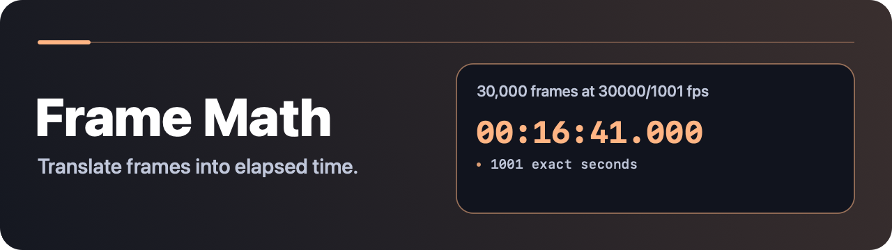

<p align="center">
  
</p>

# Frame Math

Translate elapsed time into a zero-based video frame number and back using exact rational frame rates.

## At a glance

| Task | How |
| --- | --- |
| **Frame → time** | Use `--frame` with a zero-based frame number. |
| **Time → frame** | Use `--elapsed` with an elapsed clock reading. |
| **Set the frame rate** | Pass a rational rate such as `--fps 30000/1001`. |

## Quick start

```sh
python3 frame_math.py --fps 30000/1001 --frame 30000
python3 frame_math.py --fps 24000/1001 --elapsed 00:01:12.500
```

Requires Python 3.8+. Elapsed output shows a clock rounded to milliseconds and an exact fraction in seconds. Converting elapsed time selects the nearest frame, with ties rounded to the even frame. The clock is elapsed time. It does not interpret SMPTE drop-frame labels. [MIT](LICENSE)

## Development

Run the same dependency-free regression tests used in GitHub Actions.

```sh
python3 -m unittest discover -s tests -v
```
